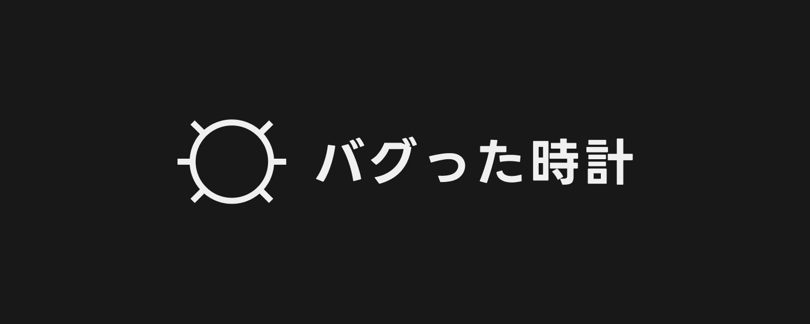
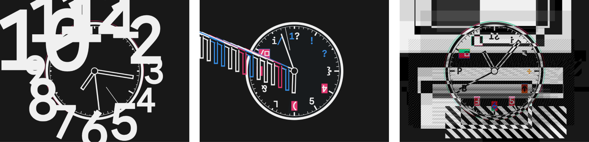
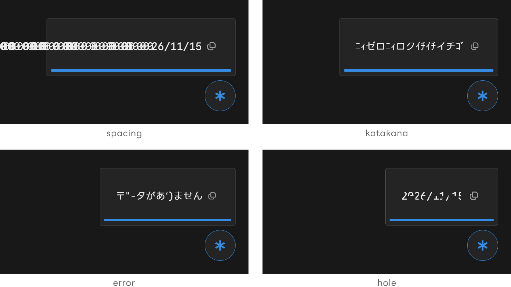

# :clock12:バグった時計

### 「バグはアートだ」

バグ風エフェクトが発生する時計を観賞するだけの、誰得サイトです。

## 現行バージョン

### 2026/11/14 更新（v0:4:0）

[**バグった時計を見る →**](https://acchinosorara.github.io/bug-clock/)

> [!NOTE]
> やや刺激の強いサイトのため、以下のいずれかに該当する場合は、閲覧を控えるか、ちょこっと覗く程度の閲覧をおすすめします。
>
> - バグった画面、挙動に抵抗のある方
> - 体調の優れない方
> - 視覚刺激に敏感な方
> - 視覚刺激により、心身に不調をきたした経験などがある方

## 仕様

### 通常エフェクト

以下のバグ風エフェクトが常時稼働します。

| エフェクト         | 範囲       | 攻撃力 |
| ------------------ | ---------- | ------ |
| ノイズ             | 全体       | ★★     |
| グリッチ           | 円盤・数字 | ★★     |
| 文字化け           | 数字       | ★★★    |
| 振動               | 時針・分針 | ★★★    |
| 高速移動           | 秒針       | ★      |
| 異常伸長           | 目盛り     | ★      |
| 波形アニメーション | 目盛り     | ★★     |

### 特殊エフェクト

通常エフェクトとは別に、一際狂ったエフェクトが確率で発生します。  
予兆なく始まるので、心臓の弱い方はご注意ください。

### 配色パターン

画面左上のロゴマークをクリックorタップすると、ページが再読み込みされ、配色パターンが切り替わります。  
色々なカラーバリエーションをお楽しみください。

### ワンタイム機能

画面右下のボタンから、現在の日付をバグ付きで生成できます（1分間有効）。  
お好みのバグ文字を探してみましょう。

## 留意事項

バグった時計の閲覧に関する留意事項は、[ABOUTページ](https://acchinosorara.github.io/bug-clock/about/) に記載しています。
